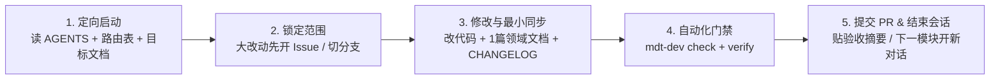

# MDT DO 开发、调试与文档协作工作流

> 目标：为所有人类协作者与 AI Agent（尤其是**单模块、短会话**的 Vibe Coding 模式）提供一套统一、防呆、可机检的开发与维护流程。

---

## 1. 信息与职责分层

维护良好的仓库需要让**文档只干文档该干的事**，过程记录与临时产物放到更合适的载体：

| 载体 | 唯一职责 | 生命周期 | 常见误用（禁止） |
|---|---|---|---|
| **`docs/`** | 描述当前生效的系统设计、配置、命令、数据结构与运维规范 | 长期维护，随代码同步更新 | 当成开发日志、贴测试计划、留存一次性审计报告 |
| **GitHub Issues** | 较大改动的需求拆解、范围边界、模块进度勾选与 Bug 追踪 | 随任务开启与关闭 | 把大改动进度写进 `docs/` 文档里 |
| **Git Commit / PR** | 记录某次改动“改了什么、为什么、怎么验的、还有哪些未验证项” | 随提交永久留档 | 用手工维护的巨型维护总览文档替代 Git 历史 |
| **`CHANGELOG.md`** | 给运维与协作者看的精炼变更摘要（每条 1–2 行） | 持续倒序追加 | 写长篇实现细节或排查步骤 |
| **`.scratch/`** | 开发中临时草稿、测试计划、实机勾选清单、排查笔记 | 仅本机存在（`.gitignore` 忽略，永不入库） | 把 `*-test-plan.md` 提交进 `docs/` |

---

## 2. 改动分级：什么时候必须开 Issue

| 级别 | 判定标准 | 流程要求 |
|---|---|---|
| **小改动** | 单脚本 Bug 修复、文案微调、单个配置项或文档纠偏 | 直接从 `main` 切分支 → 修改 → 验收 → 开 PR |
| **中/大改动** | 新增功能模块、跨多个脚本联动、修改 `wayzer/lib/*.kt` 或 `vote.lib.kt`、变更数据库表结构、Web/更新器架构改动 | **必须先开 GitHub Issue**（使用 `.github/ISSUE_TEMPLATE/feature-task.md`）明确目标与“不做什么” → 按模块拆分子任务 → 每个模块开独立会话与 PR（关联 `Refs #N` / `Closes #N`） |

---

## 3. 单模块新会话 5 步线性闭环（推荐标准流程）



### 第 1 步：定向启动（不乱扫全仓）
1. 读根目录 [AGENTS.md](../AGENTS.md) 确认红线。
2. 查 [docs/architecture.md](architecture.md) 模块路由表，定位目标代码路径与唯一对应的领域文档。
3. 只读取该 1 篇领域文档与目标源码，不在无关文件上消耗上下文。

### 第 2 步：切分支与确认边界
- 从最新 `main` 切分支：`feat/<topic>` / `fix/<topic>` / `docs/<topic>` / `chore/<topic>`。
- 中/大改动确认对应 GitHub Issue 已建立；草稿与测试清单写入 `.scratch/`。
- 如需修改 `wayzer/lib/*.kt` 或 `vote.lib.kt`，先在 Issue 说明必要性，并准备好执行**清缓存冷启动**。

### 第 3 步：修改代码 + 最小文档更新
- 遵守最小改动原则，不顺手重构或格式化无关文件。
- 仅在行为、命令、配置或数据结构变化时更新对应 **1 篇领域文档**（只改现行事实，删除过期旧描述）。
- 涉及玩家可见或运维部署变化时，在根目录 `CHANGELOG.md` 的 `Unreleased` 下追加 **1 行**摘要。

### 第 4 步：强制执行本地门禁脚本
所有验收统一走 `tools/mdt-dev.ps1`（完整命令见 [docs/dev-and-debug.md](dev-and-debug.md)）：

```powershell
# 1) 必跑：静态体检（无需服务端，秒级；覆盖 KDoc/listenTo/Depends/编码/文档卫生/敏感文件）
pwsh -NoProfile -File tools\mdt-dev.ps1 check

# 2) 脚本改动：开发途中改纯 .kts 可快速热重载
pwsh -NoProfile -File tools\mdt-dev.ps1 reload -Scripts wayzer/cmds/xxx

# 3) 脚本改动提 PR 前必跑：冷启动全量验收（改 .kt 核心库必须加 -ClearCache）
pwsh -NoProfile -File tools\mdt-dev.ps1 verify -Mode cold
#    协作者独立克隆仓库请加 -SyncToServer

# 4) Web / 邮件服务改动跑隔离冒烟
pwsh -NoProfile -File tools\mdt-dev.ps1 smoke-web
pwsh -NoProfile -File tools\mdt-dev.ps1 smoke-email
```

### 第 5 步：标准 PR 交付并结束会话
- 核对 `git status` 只含预期文件；
- 按 `.github/PULL_REQUEST_TEMPLATE.md` 填写 PR，直接粘贴 `mdt-dev.ps1` 输出的验收摘要，并如实写明**未验证项**（如需要真实玩家/客户端交互的链路）；
- **本模块完成后结束当前 AI 会话**，下一个模块开启全新对话。

---

## 4. 长期文档防退化纪律（人话规则 + 机器门禁）

<!-- doc-lint-disable -->
为杜绝历史长会话造成的文档腐烂，`tools/mdt-dev.ps1 check` 内置了文档卫生检查器，违反下列规则将直接返回失败退出码：

1. **只写现行事实，不写开发过程**  
   文档回答“现在是什么规则、怎么配置、代码在哪”。试错经过、方案对比、实机测试步骤属于过程产物，写入 `.scratch/` 或 PR 描述，绝不写进 `docs/`。
2. **禁止写入会话与 Agent 黑话**  
   严禁出现子 Agent 角色名、内部批次号或会话代号（例如 `Lead`、`punish-docs`、`punish-system`、`docs-diag`、`ipguard-audit`、`task-N`、`第X批`、`方案 A/B/C`、`Q1/N1/D1`、`已闭环基线`、`待某某回写`、`本轮实测`）。
3. **禁止随意新增临时/过程文档**  
   `docs/` 下禁止出现 `scripts-maintenance.md`、`doc-sync-audit.md`、`temp-*.md`、`*-test-plan.md`、`*-audit.md`、`*-report.md`、`*-changelog.md`、`*-draft.md`、`session-*.md`、`upstream-review-*.md`、`issue-*.md`。新增系统级文档必须在 `docs/architecture.md` 的模块路由表中登记。
4. **禁止硬编码本机路径与泄漏凭据**  
   统一使用仓库相对路径，禁止出现 `C:\Users\...`、`mdt保留\mdtdo`、`.agents\`、`复制插件用`、`../参考项目` 或任何密钥、玩家 IP、完整 UUID。
5. **保持单源与精简**  
   - `docs/backlog.md` 严格只留未完成/待验证项，完成后立刻删除，禁止保留 `✅` 或历史快照；
   - 单个领域文档建议控制在 400 行以内，超出 450 行时检查器会发出臃肿告警。
<!-- doc-lint-enable -->

---

## 5. 主服（`main`）与分服（`mdc-do`）同步协作

- **所有通用功能与 Bug 修复均先合入 `main`**，经 review 与验收后再按 [docs/mdc-do-sync.md](mdc-do-sync.md) 同步到 `mdc-do`。
- **主工作区维护者双仓同步**：在 `server/mdtdo/` 完成调试后，使用 `tools/sync-repo.ps1` 将改动安全同步到开源仓 `ScriptAgent4MindustryExt-mdtdo/`，确认 `git status` 无误后再由维护者提交与推送。
- **严禁未通过冷启动验收的代码合入主线**：编译失败等于不合格交付，不允许“先合并再修”。
